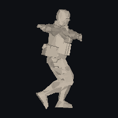
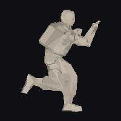

# PAPITA · Counter-Strike 1.5 en Godot 4

Recreación jugable de **Counter-Strike 1.5** en **Godot 4.4** que **lee los
assets originales del juego** — los 10 mapas `.bsp` v30, los 96 modelos `.mdl`
v10 y los 352 sonidos `.wav` que ya viven en `assets/` — con lectores de formato
escritos desde cero en GDScript.

No es una reinterpretación: la geometría, las texturas, los lightmaps de
radiosidad de 1999, los huesos y las animaciones salen de los ficheros de Valve.


*`de_dust2` reconstruido desde el `.bsp`, en planta. Los puntos azules son los
spawns y el círculo naranja el sitio de bomba A/B.*

---

## 1. Estado real (leer antes de nada)

| Pieza | Estado |
|---|---|
| Lector `.bsp` v30 (geometría, texturas, lightmaps, entidades) | **validado** contra los 10 mapas |
| Lector `.mdl` v10 (mallas, huesos, bind pose, secuencias) | **validado** contra los 96 modelos |
| Animación de esqueletos (RLE, interpolación, skinning GPU) | **validado**: 215 secuencias con movimiento real |
| Construcción del mapa en Godot (malla + colisión + atlas de luz) | escrito, **sin ejecutar** |
| Jugador, armas, audio, HUD | escrito, **sin ejecutar** |
| Modo de juego: rondas, economía, compra, C4 | escrito, **sin ejecutar** |
| Grafo de navegación sacado del `.bsp` | **validado** en los 10 mapas; 20 subidas por escalera verificadas (Python) |
| Puertas `func_door` / `func_door_rotating` | implementadas con movimiento y apertura por proximidad; 27 brush models validados estáticamente, **sin ejecutar en Godot** |
| IA de los bots: ver, apuntar, disparar y moverse | escrita, **sin ejecutar** |
| Compilar el motor Godot | **no disponible en el entorno donde se escribió** |

Lo que sí está comprobado, y cómo:

- `tools/cs15_validate.py` es un **espejo en Python** de los lectores de
  `scripts/`: misma lógica de offsets, ejecutada contra los assets reales.
  Resultado: **10/10 mapas y 96/96 modelos sin un solo problema de formato**.
- Ese mismo script **renderiza** los mapas y los modelos a PNG (los de
  `docs/previews/`), así que la geometría no solo se parsea: se dibuja.
- `tools/gdscript_check.py` valida los 19 scripts con el parser oficial de
  GDScript (`gdtoolkit`) y contrasta cada llamada a la API contra el volcado de
  la API de Godot 4.4. También cruza las llamadas y señales **entre las clases
  del propio proyecto** (que `director.comprar()` exista, que la señal
  conectada esté declarada, que un `Array[T]` no se rellene con un `Array` sin
  tipo): **0 problemas**.

Lo que **no** se puede afirmar: que el proyecto arranque en Godot. No había
Godot en el entorno (GitHub Releases está bloqueado, así que no se pudo
descargar) y no se ha podido pulsar F5 ni una vez. Espera retoques de primera
ejecución; `docs/PENDIENTE.md` lista lo que falta y lo que es probable que haya
que ajustar.

## 2. Arrancar

Requisitos: **Godot 4.4** (estándar, sin C#).

```bash
# 1) importar: abre Godot -> Import -> project.godot -> F5
# 2) o por linea de comandos:
godot --path . -- --map de_dust2
godot --path . -- --map de_nuke --arma awp
godot --path . -- --map de_dust2 --equipo t     # empezar como terrorista
godot --path . -- --map de_dust2 --rondas 10    # partida de 10 rondas
godot --path . -- --map de_dust2 --bots 8       # 8 bots (por defecto 4)
godot --path . -- --map de_dust2 --bots 0       # mapa vacío, para pasear
godot --path . -- --map de_dust2 --skill 2      # bots difíciles (0, 1, 2)
```

Si no pasas `--map`, carga `de_dust2`.

**Controles:** `WASD` mover, `Espacio` saltar, `Ctrl` agachar, `Clic izq.`
disparar, `R` recargar, `1-5` armas, `Rueda` cambiar de arma, `B` menú de
compra, `E` mantener para plantar/desactivar la C4, puertas que se abren al
acercarse, `F1` ayuda, `F5` reiniciar la partida, `Esc` liberar el ratón.

## 3. Qué hace exactamente

### Mapas
- Lee los **15 lumps** del `.bsp`, reconstruye las caras como abanicos
  triangulados y las agrupa por textura (una superficie por material).
- **Texturas**: miptex indexadas a 8 bits + `palette.lmp` → `Image` RGB.
- **Lightmaps**: empaqueta el lightmap de cada cara en un atlas único y lo
  aplica por `UV2` con `shaders/brush.gdshader`. La iluminación es la horneada
  por Valve en 1999, no luces dinámicas.
- **Colisión**: `ConcavePolygonShape3D` con los mismos triángulos.
- **Puertas móviles**: las caras de `func_door` y `func_door_rotating` se excluyen
  del mundo estático y se reconstruyen como cuerpos móviles con su malla, textura,
  lightmap y colisión. Se abren al acercarse un jugador o bot; se desplazan o giran
  y vuelven a cerrarse según `wait`.
- **Entidades**: spawns, sitios de bomba y rehenes leídos del lump de entidades.

### Modelos y animación
- Mallas por superficie, con la textura embebida en el propio `.mdl`.
- Esqueleto completo: 53 huesos por soldado, con la jerarquía del `.mdl`.
- **Animación real**: se decodifican los canales RLE del formato
  (`mstudioanim_t` + `mstudioanimvalue_t`), se interpola posición y se hace
  *slerp* de cuaterniones, exactamente como `R_StudioCalcBones` del motor.
- **Skinning en GPU**: `Skeleton3D` + `Skin` con un hueso por vértice (que es lo
  que usa el original). Animar cuesta 53 transformaciones por actor, no
  reescribir 800 vértices.
- Se reproducen las secuencias originales: `idle1`, `walk`, `run`, `crouchrun`,
  `crouch_idle`, `death1-3`, `ref_shoot_*`... Un ciclo de caminado de 30 fps dura
  33 cuadros porque así lo comprimió Valve en 1999.



*`walk` del GIGN, 33 cuadros a 30 fps, leídos del `.mdl` original.*



*`run` del terrorista, 37 cuadros a 60 fps, con la pose de fusil.*

Al arrancar aparecen **4 bots** con los modelos de las facciones originales
(`gign`, `sas`, `urban`, `gsg9`, `terror`, `leet`, `arctic`, `guerilla`). Su IA
está escrita: patrullan el grafo del mapa, ven con FOV y línea de visión,
disparan, recargan y usan las transiciones de escaleras de mano disponibles.
El código no se ha podido ejecutar en Godot aquí; `docs/PENDIENTE.md` detalla
qué se ha validado por simulación y qué falta. Las puertas también se abren por
proximidad, sin pulsar `E`.

```bash
godot --path . -- --actores 12 --secuencia run   # 12 soldados corriendo
godot --path . -- --actores 0                    # sin actores
```

### Movimiento
Constantes del motor original, en unidades GoldSrc convertidas a metros:
`sv_accelerate 10`, `sv_friction 4`, `sv_airaccelerate 10`, `sv_stopspeed 75`,
250 u/s andando, 100 u/s agachado, salto 270 u/s, gravedad 800.

### Armas
24 armas de **CS 1.5** (sin FAMAS, Galil, Five-SeveN ni escudo: esos son de
1.6). Daño, cadencia, cargador, precio y penetración de la tabla original;
dispersión que empeora al moverse o en el aire, perdigones en las escopetas,
recarga y retroceso con el viewmodel original.

### Bots

Los soldados que deambulan por el mapa **juegan**: ven al jugador si están en su
campo de visión y hay línea de visión (rayo contra la geometría real del mapa),
apuntan con el error del arma y de la dificultad, disparan en ráfagas de 3 a 6
balas, recargan y se mueven de lado en combate. Si te pierden, van a tu última
posición; si no te han visto nunca, patrullan hacia el sitio de bomba (si son
terroristas) o hacia puntos del mapa.

Se mueven por un **grafo de navegación sacado del propio `.bsp`**, no del aire:

* El árbol BSP (planos, nodos y hojas) responde si un punto es sólido, igual
  que hacía `SV_PointContents` en GoldSrc.
* Se muestrean las caras del modelo 0 cuya normal mira hacia arriba, cada 40
  unidades (1 m), aceptando solo los puntos donde cabe el actor de pie.
* Se conectan vecinos con un desnivel menor que 40 unidades (escalones y
  rampas). Además, las entidades `func_ladder` se convierten en transiciones
  verticales si hay nodos de suelo en ambos extremos y la columna está libre.
* El camino sale de un A* y se **suaviza** con cortes en línea recta; el
  suavizado se detiene en las escaleras y conserva waypoints verticales para
  que el bot suba o baje por la caja validada, no en diagonal a través del mapa.
* De los 34 triggers `func_ladder` presentes en los 10 mapas, 20 producen una
  subida navegable en 5 mapas. Los demás ya están en una zona conectada o no
  tienen dos rellanos que pasen las comprobaciones geométricas.

El porcentaje de grafo alcanzable desde alguno de los spawns sube, entre otros,
de 59,0 % a 79,4 % en `de_inferno`, de 56,7 % a 58,2 % en `de_nuke`, y de
81,5 % a 89,6 % en `de_train`. Los objetivos de juego siguen siendo alcanzables
en todos los mapas que los tienen.

Tres niveles (`--skill 0|1|2`), con los nombres de los `bot_skill` del original:

| Nivel | Reacción | Error de puntería | Visión | Aciertos a 10 m |
|---|---|---|---|---|
| fácil | 0,65 s | 3,2° | 45 m | ~90 % |
| normal | 0,38 s | 2,0° | 60 m | ~99 % |
| difícil | 0,22 s | 1,1° | 80 m | 100 % |

Los porcentajes no son inventados: `tools/bots_validate.py` replica el modelo de
disparo y los mide a 5, 10, 20 y 30 m.

### Modo de juego

Una partida de verdad sobre los `.bsp` originales, con los tiempos del 1.5:

| Pieza | Valor |
|---|---|
| Congelación (compra) | 6 s |
| Ronda | 300 s (`mp_roundtime 5`) |
| Fin de ronda | 5 s (`mp_chattime`) |
| Plantar C4 | 3 s dentro de un `func_bomb_target` |
| Explosivo | 35 s (`mp_c4timer`), 40 en el 1.6 |
| Desactivar | 10 s, 5 s con kit |
| Daño de la explosión | 200, cayendo con la distancia hasta ~12,5 m |

Fin de ronda: eliminación del bando contrario, tiempo agotado (ganan los CT),
bomba que explota (ganan los T) o bomba desactivada (ganan los CT). Se compra
en la zona de `func_buyzone` con el menú numérico del original (`B`, `1-8` para
categoría, `0` para volver), y solo durante la congelación.

Economía de 1.5: 800 $ de salida, tope 16 000 $, 3250 $ por ronda ganada por
eliminación o tiempo, 3500 $ si la ronda se decidió con la bomba, 300 $ por
baja (1500 $ con cuchillo, 150 $ con AWP), 300 $ por plantar o desactivar y
bono de derrota de 1400/1900/2400/2900 $ según las rondas perdidas seguidas.
Si sobrevives la ronda **conservas armas, chaleco y granadas**; si mueres
vuelves con cuchillo y pistola (USP si eres CT, Glock si eres T).

> Todo esto sigue **sin ejecutar en Godot**, como el resto de la escena. Lo
> que está comprobado es que compila, que las llamadas entre scripts existen y
> que las constantes son las del 1.5.

## 4. Estructura

```
project.godot           configuracion del proyecto Godot 4.4
scenes/main.tscn        escena unica (Node3D + scripts/game.gd)
icon.svg                icono propio (nada de material de Valve)

scripts/
  palette.gd            .lmp -> Color; si no hay paleta, una aproximada
  bsp_reader.gd         lector .bsp v30 (lumps, caras, texinfo, luz, entidades)
  mdl_reader.gd         lector .mdl v10 (mallas, huesos, bind pose, texturas)
  map_builder.gd        .bsp -> malla + colision + atlas de luz + ambiente
  weapon_db.gd          arsenal de CS 1.5 con estadisticas reales
  player.gd             movimiento GoldSrc, armas, raycast de disparo
  viewmodel.gd          arma en primera persona con balanceo y retroceso
  audio.gd              reproduccion de los .wav originales
  fx.gd                 impactos y trazadoras
  hud.gd                mira, vida, chaleco, municion, arma, FPS, reloj
  actor_model.gd        modelos animados de los .mdl, con vida y muerte
  economy.gd            precios, recompensas y bonos del 1.5 (puro, sin nodos)
  bomb.gd               C4: cuenta atras, pitidos, desactivacion, explosion
  match_director.gd     rondas, economia, objetivos y fin de ronda
  buy_menu.gd           menu de compra numerico estilo original
  nav_grid.gd           grafo de navegacion sacado del arbol BSP del mapa
  bot_ai.gd             percepcion, punteria y movimiento de los bots

shaders/brush.gdshader  textura + lightmap sin luces dinamicas
assets/                 material original de Valve (local, no se publica)
tools/cs15_validate.py  espejo en Python de los lectores + PNG de prueba
tools/gdscript_check.py sintaxis + API + rutas de los scripts
docs/previews/          planos de los 10 mapas y vistas de modelos
legacy/xash/            version anterior sobre el motor Xash3D-FWGS
legacy/godot/           primer intento (geometria procedural, sin assets)
```

## 5. La paleta: el detalle que lo cambia todo

Las texturas de los `.bsp` son **índices de 8 bits**; el color estaba en
`gfx/palette.lmp` del Half-Life base, que no está en el repositorio (ni en su
historial). Sin él, el proyecto usa una paleta aproximada (cubo 6×6×6 + grises)
y avisa por consola. El efecto es visible: la geometría y los rótulos se leen
perfectamente, pero los colores salen ruidosos.


*Texturas de `de_dust2` con la paleta aproximada: se reconoce "DUST II", el
crédito del autor original y los rótulos A/B/C/D de los sitios, pero el color no
es el de 1999.*

Para tener los colores reales, copia tu `palette.lmp` a cualquiera de estas
rutas y el juego la usará automáticamente:

```
assets/valve/gfx/palette.lmp
game/valve/gfx/palette.lmp
```

(Los assets de Half-Life no se incluyen: son de Valve y este repositorio no los
redistribuye. Ver `docs/AVISO_LEGAL.md`.)

## 6. Verificar sin Godot

```bash
pip install numpy pillow gdtoolkit
python3 tools/cs15_validate.py    # 96 modelos + 10 mapas + PNGs
python3 tools/partida_validate.py # modo de juego: constantes, precios, economia
python3 tools/nav_validate.py     # grafo de navegacion de los 10 mapas + PNGs
python3 tools/bots_validate.py    # punteria y daño por segundo de los bots
python3 tools/doors_validate.py   # rangos, modelos y recorridos de las 27 puertas
python3 tools/gdscript_check.py   # sintaxis, API de 4.4, cruces entre scripts
```

Salida actual:

```
modelos: 96/96 sin problemas     mapas: 10/10 ok     problemas de formato: 0
animaciones: 215/261 secuencias evaluadas se mueven (0 problemas)

== MODO DE JUEGO ==
  constantes y precios del 1.5 contrastados
  economía simulada en 200 rondas sin salirse de [0, 16000]
  problemas: 0

== NAVEGACIÓN ==
mapa           nodos  aristas  subidas  alcanza  atajos  objetivos
cs_assault      6474    22773        4    90.6%    0.0%  0/0
cs_estate       3793    12593        2    95.4%    0.0%  1/1
cs_italy        7057    22478        0    47.1%    0.3%  0/0
cs_office       7337    24587        0    53.3%    0.1%  7/7
de_aztec        6730    22347        0    83.6%    0.1%  5/5
de_dust         7122    23392        0    78.7%    0.0%  4/4
de_dust2        5391    18144        0    84.9%    0.0%  4/4
de_inferno      6814    20711        1    79.4%    0.0%  5/5
de_nuke         9853    32760        2    58.2%    0.0%  2/2
de_train        4454    14041       11    89.6%    0.0%  5/5
escaleras conectadas: 20/34 triggers
problemas: 0

puertas con brush separado: 27 entidades, 425 caras
problemas: 0

19 scripts revisados, 0 problemas
```

`partida_validate.py` lee las constantes de `economy.gd`, `match_director.gd` y
`bomb.gd` y las contrasta con el manual del 1.5 (dinero, bonos, precios,
`mp_c4timer`); después simula partidas largas para comprobar que el dinero no se
sale de `[0, 16000]` y que el bono de derrota escala como en el original. No
prueba el motor: prueba los números y la aritmética.

Las 46 secuencias que no se mueven son las **poses de apuntado** (`ref_aim_*`,
`crouch_aim_*`): tienen 1-2 cuadros idénticos porque el juego las mezcla con
los *blends* de arma, y los modelos de arma (`p_*`, `w_*`), que no se animan.

## 7. Documentación

- [`docs/ARQUITECTURA.md`](docs/ARQUITECTURA.md) — cómo se lee cada formato y por qué.
- [`docs/PENDIENTE.md`](docs/PENDIENTE.md) — qué falta, por orden de importancia.
- [`docs/ANIMACIONES.md`](docs/ANIMACIONES.md) — el formato de animación y cómo se reproduce.
- [`docs/FORMATOS.md`](docs/FORMATOS.md) — los structs del `.bsp` y del `.mdl`, campo a campo.
- [`docs/AVISO_LEGAL.md`](docs/AVISO_LEGAL.md) — licencias y qué no se publica.

## 8. Licencia

Código y documentación: **GPLv3** ([`LICENSE`](LICENSE)).
Los assets (`.bsp`, `.mdl`, `.wav`) son de **Valve Corporation** y **no** están
cubiertos por esa licencia ni se distribuyen con el proyecto.
