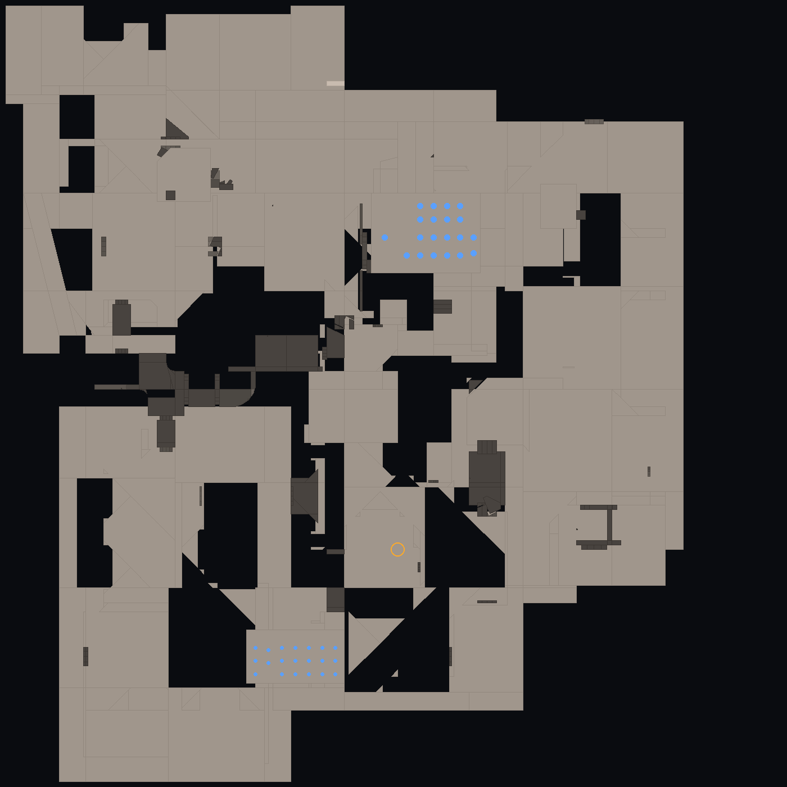
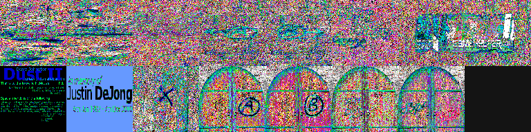

# PAPITA · Counter-Strike 1.5 en Godot 4

Recreación jugable de **Counter-Strike 1.5** en **Godot 4.4** que **lee los
assets originales del juego** — los 10 mapas `.bsp` v30, los 96 modelos `.mdl`
v10 y los 352 sonidos `.wav` que ya viven en `assets/` — con lectores de formato
escritos desde cero en GDScript.

No es una reinterpretación: la geometría, las texturas, los lightmaps de
radiosidad de 1999, los huesos y las animaciones salen de los ficheros de Valve.



*`de_dust2` reconstruido desde el `.bsp`, en planta. Los puntos azules son los
spawns y el círculo naranja el sitio de bomba A/B.*

---

## 1. Estado real (leer antes de nada)

| Pieza | Estado |
|---|---|
| Lector `.bsp` v30 (geometría, texturas, lightmaps, entidades) | **validado** contra los 10 mapas |
| Lector `.mdl` v10 (mallas, huesos, bind pose, secuencias) | **validado** contra los 96 modelos |
| Construcción del mapa en Godot (malla + colisión + atlas de luz) | escrito, **sin ejecutar** |
| Jugador, armas, audio, HUD | escrito, **sin ejecutar** |
| Compilar el motor Godot | **no disponible en el entorno donde se escribió** |

Lo que sí está comprobado, y cómo:

- `tools/cs15_validate.py` es un **espejo en Python** de los lectores de
  `scripts/`: misma lógica de offsets, ejecutada contra los assets reales.
  Resultado: **10/10 mapas y 96/96 modelos sin un solo problema de formato**.
- Ese mismo script **renderiza** los mapas y los modelos a PNG (los de
  `docs/previews/`), así que la geometría no solo se parsea: se dibuja.
- `tools/gdscript_check.py` valida los 11 scripts con el parser oficial de
  GDScript (`gdtoolkit`) y contrasta cada llamada a la API contra el volcado de
  la API de Godot 4.4: **0 problemas**.

Lo que **no** se puede afirmar: que el proyecto arranque en Godot. No había
Godot en el entorno (GitHub Releases está bloqueado, así que no se pudo
descargar) y no se ha podido pulsar F5 ni una vez. Espera retoques de primera
ejecución; `docs/PENDIENTE.md` lista lo que falta y lo que es probable que haya
que ajustar.

## 2. Arrancar

Requisitos: **Godot 4.4** (estándar, sin C#).

```bash
# 1) importar: abre Godot -> Import -> project.godot -> F5
# 2) o por linea de comandos:
godot --path . -- --map de_dust2
godot --path . -- --map de_nuke --arma awp
```

Si no pasas `--map`, carga `de_dust2`.

**Controles:** `WASD` mover, `Espacio` saltar, `Ctrl` agachar, `Clic izq.`
disparar, `R` recargar, `1-5` armas, `Rueda` cambiar de arma, `F1` ayuda,
`F5` recargar mapa, `Esc` liberar el ratón.

## 3. Qué hace exactamente

### Mapas
- Lee los **15 lumps** del `.bsp`, reconstruye las caras como abanicos
  triangulados y las agrupa por textura (una superficie por material).
- **Texturas**: miptex indexadas a 8 bits + `palette.lmp` → `Image` RGB.
- **Lightmaps**: empaqueta el lightmap de cada cara en un atlas único y lo
  aplica por `UV2` con `shaders/brush.gdshader`. La iluminación es la horneada
  por Valve en 1999, no luces dinámicas.
- **Colisión**: `ConcavePolygonShape3D` con los mismos triángulos.
- **Entidades**: spawns, sitios de bomba y rehenes leídos del lump de entidades.

### Modelos
- Mallas por superficie, con la textura embebida en el propio `.mdl`.
- Esqueleto completo: se compone la jerarquía de huesos en bind pose y se
  transforma cada vértice por el hueso al que pertenece (`vertinfo`).
- Se leen las secuencias (nombre, fps, cuadros) — reproducirlas es lo siguiente
  pendiente.

### Movimiento
Constantes del motor original, en unidades GoldSrc convertidas a metros:
`sv_accelerate 10`, `sv_friction 4`, `sv_airaccelerate 10`, `sv_stopspeed 75`,
250 u/s andando, 100 u/s agachado, salto 270 u/s, gravedad 800.

### Armas
24 armas de **CS 1.5** (sin FAMAS, Galil, Five-SeveN ni escudo: esos son de
1.6). Daño, cadencia, cargador, precio y penetración de la tabla original;
dispersión que empeora al moverse o en el aire, perdigones en las escopetas,
recarga y retroceso con el viewmodel original.

## 4. Estructura

```
project.godot           configuracion del proyecto Godot 4.4
scenes/main.tscn        escena unica (Node3D + scripts/game.gd)
icon.svg                icono propio (nada de material de Valve)

scripts/
  palette.gd            .lmp -> Color; si no hay paleta, una aproximada
  bsp_reader.gd         lector .bsp v30 (lumps, caras, texinfo, luz, entidades)
  mdl_reader.gd         lector .mdl v10 (mallas, huesos, bind pose, texturas)
  map_builder.gd        .bsp -> malla + colision + atlas de luz + ambiente
  weapon_db.gd          arsenal de CS 1.5 con estadisticas reales
  player.gd             movimiento GoldSrc, armas, raycast de disparo
  viewmodel.gd          arma en primera persona con balanceo y retroceso
  audio.gd              reproduccion de los .wav originales
  fx.gd                 impactos y trazadoras
  hud.gd                mira, vida, chaleco, municion, arma, FPS

shaders/brush.gdshader  textura + lightmap sin luces dinamicas
assets/                 material original de Valve (local, no se publica)
tools/cs15_validate.py  espejo en Python de los lectores + PNG de prueba
tools/gdscript_check.py sintaxis + API + rutas de los scripts
docs/previews/          planos de los 10 mapas y vistas de modelos
legacy/xash/            version anterior sobre el motor Xash3D-FWGS
legacy/godot/           primer intento (geometria procedural, sin assets)
```

## 5. La paleta: el detalle que lo cambia todo

Las texturas de los `.bsp` son **índices de 8 bits**; el color estaba en
`gfx/palette.lmp` del Half-Life base, que no está en el repositorio (ni en su
historial). Sin él, el proyecto usa una paleta aproximada (cubo 6×6×6 + grises)
y avisa por consola. El efecto es visible: la geometría y los rótulos se leen
perfectamente, pero los colores salen ruidosos.



*Texturas de `de_dust2` con la paleta aproximada: se reconoce "DUST II", el
crédito del autor original y los rótulos A/B/C/D de los sitios, pero el color no
es el de 1999.*

Para tener los colores reales, copia tu `palette.lmp` a cualquiera de estas
rutas y el juego la usará automáticamente:

```
assets/valve/gfx/palette.lmp
game/valve/gfx/palette.lmp
```

(Los assets de Half-Life no se incluyen: son de Valve y este repositorio no los
redistribuye. Ver `docs/AVISO_LEGAL.md`.)

## 6. Verificar sin Godot

```bash
pip install numpy pillow gdtoolkit
python3 tools/cs15_validate.py    # 96 modelos + 10 mapas + PNGs
python3 tools/gdscript_check.py   # sintaxis, API de 4.4 y rutas
```

Salida actual:

```
modelos: 96/96 sin problemas     mapas: 10/10 ok     problemas de formato: 0
11 scripts revisados, 0 problemas
```

## 7. Documentación

- [`docs/ARQUITECTURA.md`](docs/ARQUITECTURA.md) — cómo se lee cada formato y por qué.
- [`docs/PENDIENTE.md`](docs/PENDIENTE.md) — qué falta, por orden de importancia.
- [`docs/FORMATOS.md`](docs/FORMATOS.md) — los structs del `.bsp` y del `.mdl`, campo a campo.
- [`docs/AVISO_LEGAL.md`](docs/AVISO_LEGAL.md) — licencias y qué no se publica.

## 8. Licencia

Código y documentación: **GPLv3** ([`LICENSE`](LICENSE)).
Los assets (`.bsp`, `.mdl`, `.wav`) son de **Valve Corporation** y **no** están
cubiertos por esa licencia ni se distribuyen con el proyecto.
